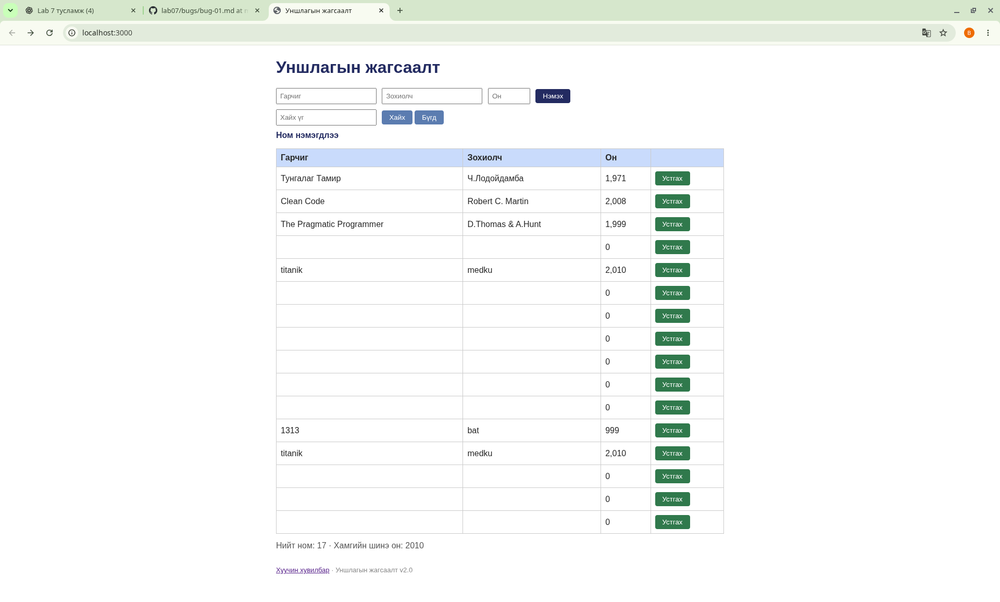

# BUG-01: Хоосон талбартай ном нэмэгдэж байна

**Төлөв:** Баталгаажсан

**Алхам:**
1. Уншлагын жагсаалтын аппыг нээв.
2. Гарчиг, зохиогч, оны талбаруудыг бүгдийг хоосон үлдээв.
3. Нэмэх товчийг дарав.

**Хүлээгдэж буй үр дүн:** Ном нэмэгдэхгүй бөгөөд ойлгомжтой алдааны мессеж гарна.

**Бодит үр дүн:** Хоосон нэртэй ном жагсаалтад нэмэгдсэн. Ямар нэгэн мессеж гараагүй.

**Нөлөөлөл:** Оролтын баталгаажуулалт буруу ажиллаж байна.

## Screenshot

